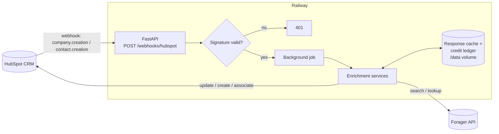

# Forager × HubSpot Enrichment

A Python service that fills in company and contact data in HubSpot using
[Forager](https://forager.ai), and finds new people at a company filtered by job title. HubSpot
webhooks trigger it automatically when a company or contact is created.

Built for the ONEGTM Lab *AI Automation Engineer* evaluation task.

---

## In simple words

- **HubSpot** is a CRM, a digital address book for a sales team. It stores **companies** and
  the **contacts** (people) who work at them.
- People usually add records with very little data, such as just "OpenAI" or just a name.
- **Forager** is a data provider. You give it a company or a person and it returns details:
  revenue, headcount, LinkedIn, email, location, and so on.
- **This service is the bridge between the two.** It runs on Railway. When someone adds a
  company or contact to HubSpot:
  1. HubSpot sends the service a notification (a **webhook**).
  2. The service asks Forager for the missing details.
  3. The service writes those details back into HubSpot.
- For a new **company**, it also handles the company's people. Contacts already in HubSpot get
  enriched. If there are none, it **finds** people at the company through Forager, filtered by
  job title, and adds them to HubSpot.

---

## What it does

| # | Feature | How |
|---|---------|-----|
| 1 | Enrich companies | Forager organization search by domain → description, revenue, headcount, industry, HQ address, LinkedIn page, founded year, keywords |
| 2 | Enrich contacts | Match the person in Forager, then fill name, title, LinkedIn, employer, work email, city/state/country, plus headline, About and skills |
| 3 | Find contacts at a company | Forager role search filtered to the company's current employees with matching **job titles**; each person's work email is looked up and they are created in HubSpot and linked to the company |
| 4 | Company webhook | `company.creation` → enrich the company → enrich its existing contacts, **or** find new ones if it has none |
| 5 | Contact webhook | `contact.creation` → enrich that contact |

---

## How it works



**Webhook handling.** The endpoint checks HubSpot's `X-HubSpot-Signature-v3` (HMAC-SHA256
with the app's client secret; v1/v2 also accepted), replies `200` immediately, and queues one
background job per event. Duplicate deliveries are dropped by event ID. Each job waits
`WEBHOOK_DELAY_SECONDS` first, so an association made right after creation (for example, a
contact added to a new company) is visible before the service decides what to do.

**Company flow.**
1. Read the company from HubSpot. Skip it if `forager_enriched_at` is already set.
2. Forager organization search by domain (or LinkedIn company page if there's no domain).
3. Write the company fields. Existing values are kept unless `ENRICHMENT_OVERWRITE=true`.
4. If the company has contacts, enrich each (up to `MAX_CONTACTS_PER_COMPANY`). If it has none,
   run the contact finder.

**Contact flow.** The person is matched in Forager with the cheapest method that works:
1. LinkedIn URL → role search (1 credit)
2. First + last name at the contact's company → role search (1 credit), only if exactly one
   person matches
3. Email → reverse lookup (5 credits)

Then the work email is looked up if the contact has none, and the contact is updated.

**Contact finder.** One role search returns current employees whose title matches any of the
requested titles. Results are ordered round-robin across titles, so five people come from five
different roles. For each person: skip if already in HubSpot, look up the work email, skip if
none is found (Forager doesn't charge for misses), otherwise create the contact and associate
it with the company.

**Loop guard.** Contacts created by the finder are marked `enrichment_source=forager_finder`.
Their own `contact.creation` webhooks are skipped, so nothing is paid for twice.

**Credit safety.**
- Every paid Forager call reserves its cost from `FORAGER_CREDIT_BUDGET` before it is sent.
  A call that would exceed the budget is refused.
- Every Forager response is cached on disk, so repeating a lookup is free.
- `FORAGER_MODE=mock` serves fake data from a built-in Forager mock: 0 credits.

---

## Fields written to HubSpot

### Contacts

| Data | Property |
|------|----------|
| First / last name | `firstname`, `lastname` |
| Job title | `jobtitle` |
| Person LinkedIn URL | `linkedin_url` (custom) |
| Employer name, domain, LinkedIn | `company`, `website`, `company_linkedin_url` (custom) + association to the company |
| Work email | `email` |
| Phone | `phone`. **Off by default** (`ENABLE_PHONE_LOOKUP`), see [Credits](#credits) |
| City / state / country | `city`, `state`, `country` |
| Extra: headline, About, skills, current role start | `linkedin_headline`, `linkedin_about`, `linkedin_skills`, `current_role_start` (custom) |
| Bookkeeping | `forager_person_id`, `forager_enriched_at`, `forager_enrichment_status`, `enrichment_source` (custom) |

### Companies

| Data | Property |
|------|----------|
| Name, domain, website | `name`, `domain`, `website` |
| Description | `description` |
| Revenue | `annualrevenue` |
| Headcount | `numberofemployees` |
| Industry | `industry` when the LinkedIn industry matches a HubSpot option; always `forager_industry` (custom) |
| LinkedIn page | `linkedin_company_page` |
| Founded year | `founded_year` |
| HQ address | `address`, `city`, `state`, `zip`, `country` |
| Extra: keywords, employee range | `forager_keywords`, `forager_employees_range` (custom) |
| Bookkeeping | `forager_org_id`, `forager_enriched_at`, `forager_enrichment_status` (custom) |

Custom properties are created by `scripts/setup_hubspot_properties.py`. The other Forager
fields worth discussing are in [docs/forager-extra-fields.md](docs/forager-extra-fields.md).

---

## Credits

From Forager's [API Credit Pricing](https://docs.forager.ai/api-overview/credit-pricing):
organization search 1, role search 1, work email 5 (only when found), reverse email 5,
**phone 15**.

This account has **50 credits**, so phone lookups are switched off. Five phones alone would
cost 75. The code supports them: set `ENABLE_PHONE_LOOKUP=true` with a larger budget.

| Step | Credits |
|------|--------:|
| OpenAI company search | 1 |
| People search for the 5 titles | 1 |
| 5 work emails | 25 |
| **Primary deliverable** | **27** |
| Job-title filtering demo (2 previews) | 2 |
| Contact webhook demo (name match + email) | 6 |
| **Total** | **35** of the 45 budget |

`GET /credits` shows what the service has spent and the live balance Forager reports.

---

## Endpoints

| Method | Path | Auth | Purpose |
|--------|------|------|---------|
| `GET` | `/health` | none | Health check |
| `POST` | `/webhooks/hubspot` | HubSpot signature | Receives HubSpot webhook batches |
| `POST` | `/enrich/company/{id}?force=false` | `X-Admin-Key` | Run the full company flow now |
| `POST` | `/enrich/contact/{id}?force=false` | `X-Admin-Key` | Enrich one contact now |
| `POST` | `/companies/{id}/find-contacts` | `X-Admin-Key` | Find people by job title. Body: `{"titles": ["CTO"], "limit": 5, "preview": true}` |
| `GET` | `/credits` | `X-Admin-Key` | Credits spent, remaining, and Forager's live balance |
| `GET` | `/docs` | none | Interactive API docs (FastAPI) |

`preview: true` only runs the search (1 credit) and lists who matched, without buying emails or
writing to HubSpot. It's the cheap way to show job-title filtering:

```bash
curl -X POST "$URL/companies/$COMPANY_ID/find-contacts" \
  -H "X-Admin-Key: $ADMIN_API_KEY" -H "Content-Type: application/json" \
  -d '{"titles": ["Recruiter"], "preview": true}'
```

---

## Configuration

All settings come from environment variables (Railway service variables, or `.env` locally).
Nothing secret is in the code. See [.env.example](.env.example).

| Variable | Default | Description |
|----------|---------|-------------|
| `FORAGER_MODE` | `mock` | `mock` (fake data, 0 credits) or `live` |
| `FORAGER_API_KEY` | | Forager API key |
| `FORAGER_ACCOUNT_ID` | | Forager account ID (find it with `scripts.forager_check accounts`) |
| `FORAGER_CREDIT_BUDGET` | `45` | Hard cap on credits the service may spend |
| `FORAGER_CACHE_DIR` | `.forager_cache` (`/data/forager_cache` in Docker) | Response cache and credit ledger |
| `FORAGER_EMAIL_TIMEOUT_SECONDS` | `180` | How long to wait for a work email job |
| `ENABLE_PHONE_LOOKUP` | `false` | Phone lookups (15 credits each) |
| `HUBSPOT_ACCESS_TOKEN` | | Private app access token |
| `HUBSPOT_CLIENT_SECRET` | | Private app client secret, used to verify webhooks |
| `PUBLIC_BASE_URL` | | Public URL of the service, e.g. `https://x.up.railway.app` (webhook signatures are computed over it) |
| `DEFAULT_JOB_TITLES` | `Account Executive,Recruiter,Solutions Engineer,Partnerships,Customer Success` | Titles the company webhook searches for |
| `MAX_CONTACTS_PER_COMPANY` | `5` | Contacts found or enriched per company |
| `WEBHOOK_DELAY_SECONDS` | `10` | Wait before processing a webhook event |
| `ENRICHMENT_OVERWRITE` | `false` | Replace existing HubSpot values (email and domain never are) |
| `ADMIN_API_KEY` | | Required for the admin endpoints |
| `LOG_LEVEL` / `LOG_FORMAT` | `INFO` / `json` | Logging |

---

## Running locally

Needs [uv](https://docs.astral.sh/uv/).

```bash
uv sync                          # installs Python 3.12 deps into .venv
cp .env.example .env             # then fill in keys
uv run uvicorn app.main:create_app --factory --reload
uv run pytest                    # 80 tests, all against mocks, 0 credits
uv run ruff check . && uv run mypy app scripts
```

To receive HubSpot webhooks on your machine, expose the port with `ngrok http 8000` and use
that URL as `PUBLIC_BASE_URL` and as the webhook target.

---

## Setup

### 1. Forager

1. Copy your API key into `FORAGER_API_KEY`.
2. Find your account ID and balance (free):
   `uv run python -m scripts.forager_check accounts`
3. Check how many people match each title before spending anything. It prints the balance
   before and after, which confirms the totals endpoint is free:
   `uv run python -m scripts.forager_check totals --domain openai.com --titles "Account Executive" "Recruiter"`
4. See exactly what the finder would write for those people, without touching HubSpot
   (1 credit):
   `uv run python -m scripts.forager_check preview --domain openai.com --titles "Account Executive" "Recruiter"`

### 2. HubSpot

1. In HubSpot go to **Development → Legacy apps → Create legacy app → Private**.
2. **Scopes:** `crm.objects.companies.read`, `crm.objects.companies.write`,
   `crm.objects.contacts.read`, `crm.objects.contacts.write`, `crm.schemas.companies.write`,
   `crm.schemas.contacts.write`.
3. Create the app. Copy the **access token** into `HUBSPOT_ACCESS_TOKEN` and the **client
   secret** into `HUBSPOT_CLIENT_SECRET`.
4. Create the custom properties (safe to re-run):
   `uv run python -m scripts.setup_hubspot_properties`
5. After deploying (below), open the app's **Webhooks** tab:
   - Target URL: `https://<your-app>.up.railway.app/webhooks/hubspot`
   - Create subscriptions: **Company → Created** and **Contact → Created**.
6. Optional, for a clean demo: HubSpot can auto-create companies from contact emails, and can
   auto-fill company fields from the domain. Either can trigger extra webhooks or hide Forager's
   values, so consider turning them off in the portal's company settings.

### 3. Railway

1. Push this repository to GitHub, then in Railway: **New Project → Deploy from GitHub repo**.
   Railway builds the `Dockerfile` and uses `railway.json` for the `/health` check.
2. Add a **volume** mounted at `/data`, so the response cache and credit ledger survive
   redeploys.
3. **Settings → Networking → Generate Domain**, then set `PUBLIC_BASE_URL` to that URL.
4. Add the variables: `FORAGER_MODE`, `FORAGER_API_KEY`, `FORAGER_ACCOUNT_ID`,
   `FORAGER_CREDIT_BUDGET=45`, `HUBSPOT_ACCESS_TOKEN`, `HUBSPOT_CLIENT_SECRET`,
   `PUBLIC_BASE_URL`, `ADMIN_API_KEY`, `DEFAULT_JOB_TITLES`.
5. Check `https://<your-app>.up.railway.app/health`.
6. Test the whole flow with `FORAGER_MODE=mock` first. Switch to `live` only for the demo.

---

## Demo runbook (for the video)

1. Railway variables: `FORAGER_MODE=live`, `FORAGER_CREDIT_BUDGET=45`,
   `ENABLE_PHONE_LOOKUP=false`. Open HubSpot and the Railway logs side by side.
2. **Create the company by hand** in HubSpot: name `OpenAI`, domain `openai.com`.
3. Within seconds the logs show `webhook_received` → `company_enriched` →
   `contact_created` ×5 → `contact_finder_done`.
4. Open the company in HubSpot and show the filled fields and the 5 associated contacts.
5. **Job-title filtering:** call `find-contacts` with `preview: true` and two different title
   sets, and show different people come back (1 credit each).
6. **Contact webhook:** pick a person from a preview who isn't in HubSpot yet. Create them by
   hand with first and last name, associated with the OpenAI company in the create form. The
   webhook matches them by name at that company and fills them in (about 6 credits).
7. `GET /credits` shows the total spent.

---

## Project structure

```
app/
  main.py               FastAPI app and routes
  config.py             Settings from environment variables
  container.py          Builds clients/services; runs webhook jobs
  webhooks.py           Signature checks, event parsing, de-duplication
  credits.py            Credit budget and ledger
  cache.py              On-disk Forager response cache
  mapping.py            Forager → HubSpot field mapping and cleaning
  models.py             Typed Forager and HubSpot payloads
  properties.py         HubSpot property names and custom property definitions
  clients/
    forager.py          Forager API client
    forager_mock.py     Fake Forager for FORAGER_MODE=mock
    hubspot.py          HubSpot API client
  services/
    company.py          Company flow
    contact.py          Contact flow and matching
    finder.py           Job-title contact finder
    lookups.py          Paid email/phone lookups
    results.py          Result models
scripts/
  setup_hubspot_properties.py
  forager_check.py      Account ID, balance, and free title counts
tests/                  80 tests, run against the Forager mock and a fake HubSpot
docs/forager-extra-fields.md
```

---

## Tech stack

| Layer | Choice |
|-------|--------|
| Language | Python 3.12 |
| Web framework / server | FastAPI, Uvicorn |
| HTTP client | httpx (async), tenacity for retries on 429/5xx |
| Models and config | Pydantic v2, pydantic-settings |
| Logging | structlog (JSON lines) |
| Data provider | Forager API v2 |
| CRM | HubSpot CRM API v3, Associations API v4, webhooks |
| Packaging / container / hosting | uv, Docker, Railway |
| Tests and quality | pytest, pytest-asyncio, respx, ruff, mypy (strict) |

---

## Decisions and limitations

- **Phone numbers are skipped** to fit the 50-credit account. Supported behind
  `ENABLE_PHONE_LOOKUP`.
- **The OpenAI demo company is created by hand** in HubSpot so the webhook fires live on video.
- **Extra LinkedIn fields are stored** (headline, About, skills, current role start).
- **Not verified against live APIs yet.** Everything is tested against a mock built from
  Forager's OpenAPI spec and a fake HubSpot. A few response details need checking on the first
  live run: the shape of work email results, the person `location` format, and whether lookups
  that find nothing are charged (the ledger assumes they are, except work email).
- Webhook de-duplication and the "already running" guard are in memory, so they reset on
  restart. The `forager_enriched_at` property is the durable guard against paying twice.
